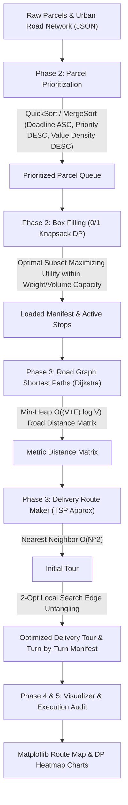

# Intelligent Courier Planning System
### Design and Analysis of Algorithms (DAA) — Capstone Project (100 Marks)

[]()
[]()
[]()

An integrated algorithmic decision-support engine that solves the multi-tier courier delivery problem by combining:
1. **Multi-Criteria Sorting** (QuickSort with Median-of-Three & MergeSort) for parcel prioritization.
2. **Dynamic Programming** (0/1 Knapsack) for optimal box packing and vehicle capacity maximization.
3. **Graph Theory** (Dijkstra's Algorithm with Min-Heap) for all-pairs road shortest paths.
4. **Approximation Algorithms** (Nearest-Neighbor Heuristic + 2-Opt Local Search) for Traveling Salesperson Problem (TSP) delivery tour generation.

---

## 🏗️ System Architecture & Workflow Pipeline



---

## 📁 Repository Structure

```
Capstone_DAA/
├── README.md                      # Project overview, setup, and usage guide
├── requirements.txt              # Core Python dependencies
├── pytest.ini                    # Test runner configuration
├── main.py                       # Interactive CLI entrypoint
├── benchmark.py                  # Phase 4 performance profiling & chart generator
├── run_demo.py                   # Automated end-to-end demonstration script
├── data/                         # Reproducible benchmark datasets
│   ├── small_dataset.json        # Small fleet (N=10 parcels, 6 hubs)
│   ├── medium_dataset.json       # Medium territory (N=35 parcels, 15 hubs)
│   ├── city_courier_scenario.json # Metro city scenario (N=50 parcels, 20 hubs)
│   ├── large_dataset.json        # Commercial fleet (N=100 parcels, 35 hubs)
│   └── generate_datasets.py      # Synthetic dataset generator
├── src/                          # Modular algorithmic engine
│   ├── __init__.py
│   ├── models.py                 # Parcel, DeliveryPoint, RoadNetwork, PackingPlan
│   ├── sorting.py                # QuickSort (Median-of-3) & MergeSort with metrics
│   ├── knapsack_dp.py            # 0/1 Knapsack DP (2D matrix + item backtracking)
│   ├── graph.py                  # Road network adjacency list & Euclidean geometry
│   ├── dijkstra.py               # Min-heap shortest path & path reconstruction
│   ├── tsp_approx.py             # Nearest Neighbor, 2-Opt, and Exact Brute-Force TSP
│   ├── pipeline.py               # Integrated coordinator connecting all phases
│   └── visualizer.py             # Matplotlib route maps, DP heatmaps & runtime plots
├── tests/                        # 100% passing test suite (14 tests)
│   ├── test_sorting.py           # QuickSort & MergeSort stability & order tests
│   ├── test_knapsack.py          # DP correctness, capacity limit & 2D knapsack tests
│   ├── test_dijkstra.py          # Shortest paths & metric distance matrix tests
│   ├── test_tsp.py               # Tour validity, 2-opt untangling & approximation tests
│   └── test_pipeline.py          # Integrated end-to-end pipeline execution test
├── report/
│   └── CAPSTONE_REPORT.md        # Complete 100-mark academic Capstone submission report
└── output/                       # Generated outputs and artifacts
    ├── charts/                   # Publication-quality PNG plots
    │   ├── small_route_map.png
    │   ├── small_dp_heatmap.png
    │   ├── city_route_map.png
    │   ├── city_dp_heatmap.png
    │   ├── sorting_runtime_comparison.png
    │   ├── knapsack_runtime_comparison.png
    │   ├── tsp_runtime_comparison.png
    │   └── pipeline_latency_breakdown.png
    └── execution_logs.txt        # Full output trace of all demonstration runs
```

---

## ⚡ Quickstart & Installation

### 1. Prerequisites
- Python 3.10+ (tested on Python 3.10 through 3.14 on macOS / Linux / Windows).

### 2. Environment Setup
```bash
# Clone the repository
git clone <repository-url>
cd Capstone_DAA

# Create and activate virtual environment
python3 -m venv .venv
source .venv/bin/activate       # On Windows: .venv\Scripts\activate

# Install required packages
pip install -r requirements.txt
```

### 3. Run Automated Demonstration
Executes small & city scenario runs, benchmarks all components, outputs charts and generates logs:
```bash
python run_demo.py
```

### 4. Run Interactive CLI
```bash
# Run Small Fleet scenario with QuickSort and DP Table output
python main.py --dataset data/small_dataset.json --sort quicksort

# Run Metropolitan City scenario with MergeSort and 2-Opt optimization
python main.py --dataset data/city_courier_scenario.json --sort mergesort

# View help and command-line flags
python main.py --help
```

### 5. Run Unit & Integration Test Suite
```bash
pytest -v
```

---

## 📊 Summary of Algorithmic Components

| Component | Selected Algorithm | Time Complexity | Space Complexity | Role in System |
| :--- | :--- | :--- | :--- | :--- |
| **Prioritization** | QuickSort (Median-of-3) & MergeSort | $O(N \log N)$ | $O(\log N)$ / $O(N)$ | Ranks parcels by SLA deadline, priority tier, and value density. |
| **Box Packing** | 0/1 Knapsack Dynamic Programming | $O(N \cdot W)$ | $O(N \cdot W)$ | Selects the utility-maximizing subset of parcels fitting vehicle payload. |
| **Shortest Paths** | Dijkstra with Binary Min-Heap | $O((V + E) \log V)$ | $O(V + E)$ | Computes all-pairs shortest road distance & turn-by-turn routing between active stops. |
| **Route Maker** | Nearest-Neighbor + 2-Opt Heuristic | $O(N^2)$ per pass | $O(N)$ | Computes the delivery tour visiting all selected customer stops and returning to depot. |
| **Exact Verification** | Brute-Force Permutations | $O(N!)$ | $O(N)$ | Validates approximation ratio on small instances ($N \le 9$). |

---

## 📈 Visual Outputs

Generated automatically in `output/charts/`:
1. `small_route_map.png` & `city_route_map.png`: Spatial delivery network displaying depot, customer locations, road segments, and directional delivery tour arrows.
2. `small_dp_heatmap.png` & `city_dp_heatmap.png`: Heatmap visualization of the 0/1 Knapsack DP state matrix.
3. `sorting_runtime_comparison.png`: Empirical runtime scaling of QuickSort vs MergeSort vs TimSort ($N=10$ to $1000$).
4. `knapsack_runtime_comparison.png`: Empirical runtime scaling of 0/1 Knapsack DP vs state space size $(N \times W)$.
5. `tsp_runtime_comparison.png`: Runtime comparison of Exact Brute-Force ($O(N!)$) vs Nearest Neighbor ($O(N^2)$) and 2-Opt.
6. `pipeline_latency_breakdown.png`: Millisecond latency contribution of each pipeline phase.

---

## 📖 Capstone Report
For the complete 100-mark theoretical and practical documentation covering all 5 Phases with proofs, pseudocode, DP tables, and complexity audits, refer to [report/CAPSTONE_REPORT.md](file:///Users/bhavya/Desktop/%20/Sem_3/Design%20Algo/Capstone_DAA/report/CAPSTONE_REPORT.md).
